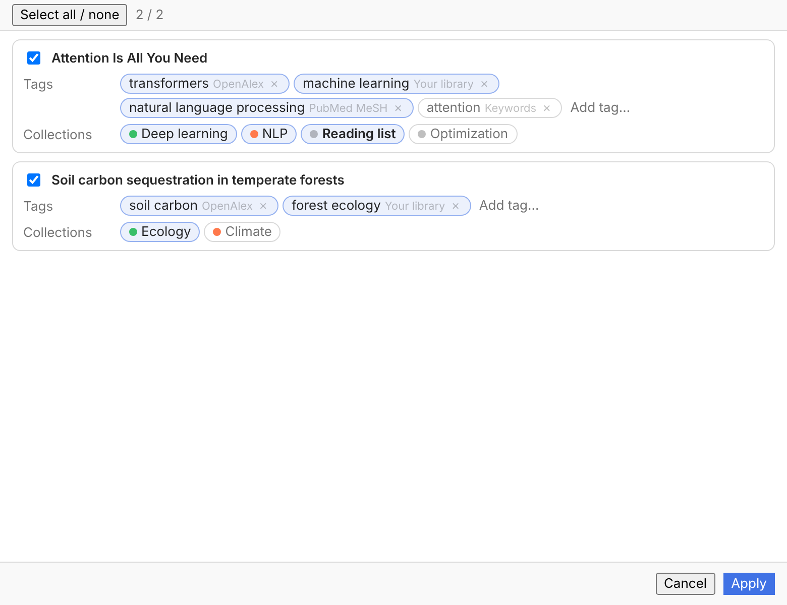

<div align="center">

# RefWright

**One Zotero plugin for the chores around a paper.**
Find the PDF. Check it isn't retracted. Check its citation data. Tag it. File it.

[](https://github.com/noahweidig/refwright/releases)
[](LICENSE)
[](https://www.zotero.org)

 No accounts &nbsp;·&nbsp; No analytics &nbsp;·&nbsp; No server &nbsp;·&nbsp;  AI is optional

<picture>
  <source media="(prefers-color-scheme: dark)" srcset="docs/img/review-dark.png">
  
</picture>

</div>

## Features

|                                                                    |                      |                                                                                                                                                     |
| ------------------------------------------------------------------ | -------------------- | --------------------------------------------------------------------------------------------------------------------------------------------------- |
|          | **PDFs**             | Legal open-access only, from a fixed source order. Validates `%PDF-`, 10 KB to 100 MB, and rejects wrong-paper PDFs. Preview mode attaches nothing. |
|       | **Integrity**        | Retraction check (PubMed, then Crossref/Retraction Watch) and a read-only citation check against Crossref.                                          |
|               | **Tags**             | Free (your library, OpenAlex, PubMed, offline keywords) or AI. Cleanup rules, review window, learning from your edits, Tag Manager with undo.       |
|       | **Collections**      | Offline TF-IDF ranking by default; optional embeddings or LLM. Batch review, inbox triage, one-step undo.                                           |
|        | **Library health**   | Wrong item type, missing DOI or abstract, broken attachments, standalone PDFs, inconsistent author names. Batch fix.                                |
|     | **Preprint upgrade** | Finds the journal version of an arXiv or bioRxiv item and upgrades it in place, with the final PDF.                                                 |
|           | **Bookmarks**        | Page bookmarks in the PDF reader, stored as synced annotations, with next/previous and open-at-last.                                                |
|        | **Reading queue**    | Unread/Reading/Done as synced tags, sortable status, read-time and relevance columns, and Select Next Up ranked against the selected collection.    |
|  | **Zotero-native UI** | Right-click menu, Tools menu, item column, item pane section, preferences pane. Zotero's own theme variables, so light and dark follow Zotero.      |
|           | **Local API**        | Write-back API, off by default. Token, tag-prefix allowlist, audit log, undo.                                                                       |

<details>
<summary>PDF source order</summary>

Unpaywall, PMC, Europe PMC, Semantic Scholar, Crossref, CORE, OpenAIRE, preprint servers, HAL, DOAJ, OSTI, IA Scholar, OpenAlex, Internet Archive retry, then Zotero's own downloader.

</details>

<details>
<summary>AI providers for tagging</summary>

OpenAI, Anthropic, Gemini, DeepSeek, OpenRouter, Cohere, custom endpoints, and Ollama for fully local use.

</details>

Status tags written by RefWright (`fulltext:`, `retraction:`, `citation:`, `code:`, `data:`, `refwright:`) are never suggested, cleaned or merged.

###  Install

1. Download the latest `.xpi` from [Releases](https://github.com/noahweidig/refwright/releases).
2. In Zotero 8+: **Tools → Plugins → ⚙ → Install Plugin From File…**

###  Documentation

Guides for every feature live in [`docs/`](docs): [getting started](docs/getting-started.md), [PDFs](docs/pdfs.md), [integrity](docs/integrity.md), [tags](docs/tags.md), [collections](docs/collections.md), [library health](docs/library-health.md), [preprint upgrade](docs/preprint-upgrade.md), [bookmarks](docs/bookmarks.md), [reading queue](docs/reading-queue.md), [code and data links](docs/code-links.md), [providers](docs/providers.md), [API](docs/api.md), [privacy](docs/privacy.md).

Build the site: `pip install zensical && zensical build`. Lucide icons live in `overrides/.icons/lucide`.

###  Develop

```bash
npm ci
npm run check      # tsc, eslint, prettier, vitest
npm run build
npm start          # needs .env, see .env.example
```

Pure logic lives in `src/core` (no Zotero globals, unit-tested in `unit/`). Zotero wiring is in `src/zotero`, window scripts in `src/ui`. Built from [zotero-plugin-template](https://github.com/windingwind/zotero-plugin-template).

> **Status:** core logic is unit-tested. The Zotero integration layer has not been run inside a live Zotero yet. See the [changelog](CHANGELOG.md).

###  License

[AGPL-3.0-or-later](LICENSE). Icons by [Lucide](https://lucide.dev) (ISC).
