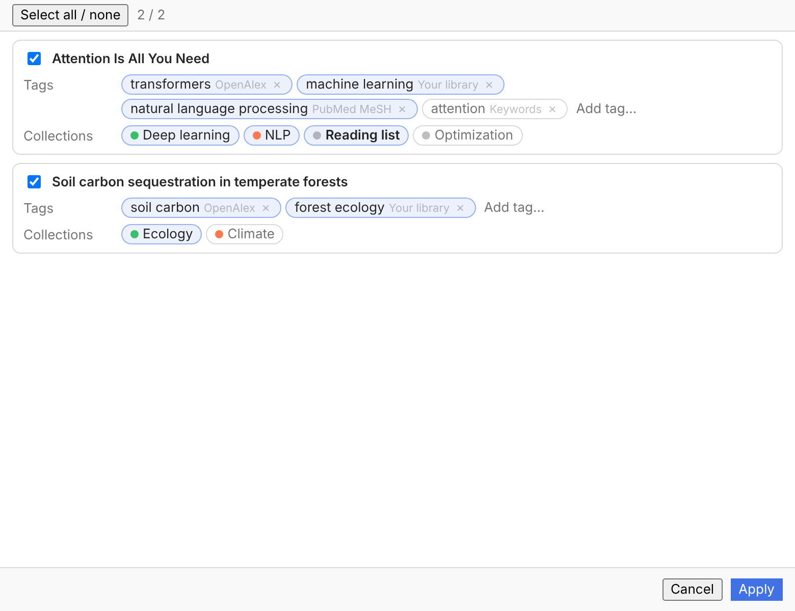

# carrel

One Zotero plugin for the chores around a paper: find the PDF, check it isn't retracted, check its citation data, tag it, file it. No accounts, no analytics, no server. AI is optional.

Zotero 8+. Built from [zotero-plugin-template](https://github.com/windingwind/zotero-plugin-template).

## What it does

- **PDFs**: legal open-access only. Fixed source order (Unpaywall, PMC, Europe PMC, Semantic Scholar, Crossref, CORE, OpenAIRE, preprint servers, HAL, DOAJ, OSTI, IA Scholar, OpenAlex, Internet Archive retry, Zotero's own downloader). Validates `%PDF-`, 10 KB–100 MB, rejects wrong-paper PDFs. Preview mode attaches nothing.
- **Integrity**: retraction check (PubMed, then Crossref/Retraction Watch) and read-only citation check against Crossref.
- **Tags**: free (your library, OpenAlex, PubMed, offline keywords) or AI (OpenAI, Anthropic, Gemini, DeepSeek, OpenRouter, Cohere, custom, Ollama). Cleanup rules, review window, learning from your edits, Tag Manager with undo.
- **Collections**: offline TF-IDF ranking by default; optional embeddings or LLM. Batch review, inbox triage, one-step undo.
- **Zotero-native UI**: right-click menu, Tools menu, sortable item column, item pane section, preferences pane. Windows use Zotero's own theme variables, so light/dark follow Zotero.
- **Local write-back API** (off by default, token + tag-prefix allowlist, audit log, undo).

Status tags written by carrel (`fulltext:`, `retraction:`, `citation:`, `carrel:`) are never suggested, cleaned or merged.



## Develop

```bash
npm ci
npm run check      # tsc, eslint, prettier, vitest
npm run build
npm start          # needs .env, see .env.example
```

Pure logic lives in `src/core` (no Zotero globals, unit-tested in `unit/`). Zotero wiring is in `src/zotero`, window scripts in `src/ui`.

## Status

0.1.0. Core logic is unit-tested (57 tests). The Zotero integration layer has not been run inside a live Zotero yet.

License: AGPL-3.0-or-later.
